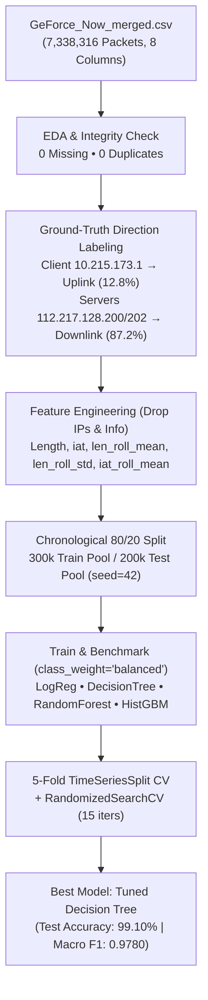

# 5G Game-Streaming Traffic: Packet Direction Classification


A machine learning network-traffic classification project that classifies packets from a **5G GeForce NOW cloud game-streaming session** (`7,338,316` captured packets) into **Uplink** (client-to-server) or **Downlink** (server-to-client) using exclusively packet length and inter-arrival timing features without IP address target leakage.

---

## Table of Contents

- [Project Introduction](#project-introduction)
- [Problem Statement](#problem-statement)
- [Project Objectives](#project-objectives)
- [Key Features](#key-features)
- [Technology Stack](#technology-stack)
- [Visualizations & Notebook Plots](#visualizations--notebook-plots)
- [Architecture & ML Pipeline Diagram](#architecture--ml-pipeline-diagram)
- [Application Workflow](#application-workflow)
- [Project Directory Structure](#project-directory-structure)
- [Dataset Schema & Target Formulation](#dataset-schema--target-formulation)
- [Feature Engineering & Model Results](#feature-engineering--model-results)
- [Installation Instructions](#installation-instructions)
- [Environment Variables](#environment-variables)
- [How to Run Locally](#how-to-run-locally)
- [Usage Examples & Real-World Scenarios](#usage-examples--real-world-scenarios)
- [Evaluation & Verification Results](#evaluation--verification-results)
- [Deployment & Inference Integration](#deployment--inference-integration)
- [Security & Data Leakage Considerations](#security--data-leakage-considerations)
- [Future Improvements](#future-improvements)
- [Contribution Guidelines](#contribution-guidelines)
- [License](#license)
- [Author](#author)

---

## Project Introduction

Modern 5G Quality-of-Service (QoS) engines and network slice monitors need lightweight packet classifiers that operate strictly on anonymized metadata (packet byte length and timing) without inspecting encrypted payloads or memorizing IP addresses. Using a 7.33M-packet Wireshark-style capture from a 5G GeForce NOW session, this project builds and benchmarks 4 scikit-learn classifiers, reaching **99.10% test accuracy** and **0.9780 Macro F1** with a tuned `DecisionTreeClassifier`.

---

## Problem Statement

1. **No Predefined Direction Label:** The raw packet capture contains 8 Wireshark trace columns (`No.`, `Time`, `Source`, `Destination`, `Protocol`, `Length`, `Info`, `source_file`) with no explicit classification label, and `Protocol` is unsuitable (`99.9%` UDP across `7,330,803` packets).
2. **Target Leakage Risk:** Using `Source`/`Destination` IP addresses or packet `Info` strings directly as model features would trivialize training while failing completely on unseen IP endpoints.
3. **Class Imbalance & Temporal Drift:** Downlink video stream packets account for `87.2%` (`6,398,920` packets) vs `12.8%` Uplink (`939,396` packets), requiring chronological splitting and balanced class weighting.

---

## Project Objectives

- Clean and audit a multi-million-row network packet capture (`0` missing values, `0` duplicates across `7,338,316` rows).
- Formulate a leakage-free binary classification task (**Uplink vs. Downlink**) using only packet size and temporal inter-arrival features.
- Benchmark linear (`LogisticRegression`) vs tree/ensemble (`DecisionTreeClassifier`, `RandomForestClassifier`, `HistGradientBoostingClassifier`) models on chronological splits.
- Validate generalization with 5-fold `TimeSeriesSplit` cross-validation and `RandomizedSearchCV` hyperparameter optimization.

---

## Key Features

- **Zero-Leakage Feature Engineering:** Drops IPs, `Info`, timestamps, sequence numbers, and filenames; retains 5 numerical signals (`Length`, `iat`, `len_roll_mean`, `len_roll_std`, `iat_roll_mean`).
- **Chronological Evaluation Strategy:** Splits first 80% capture chronologically as the training pool (`300,000` sampled packets, `random_state=42`) and final 20% as the held-out test pool (`200,000` packets).
- **Imbalance Handling:** Applies `class_weight="balanced"` and optimizes **Macro F1** alongside Uplink precision/recall.
- **Complete Workflow Documentation:** Paired Jupyter notebook [`Ge_force.ipynb`](./Ge_force.ipynb) and step-by-step plain-text technical specification [`ML_Process_Explanation.txt`](./ML_Process_Explanation.txt).

---

## Technology Stack

| Component | Technologies Verified in `Ge_force.ipynb` |
| :--- | :--- |
| **Language** | Python `3.10+` |
| **Data Processing** | `pandas`, `numpy`, `gc` |
| **Machine Learning** | `scikit-learn` (`StandardScaler`, `LogisticRegression`, `DecisionTreeClassifier`, `RandomForestClassifier`, `HistGradientBoostingClassifier`, `TimeSeriesSplit`, `RandomizedSearchCV`, `make_pipeline`) |
| **Visualization** | `matplotlib`, `seaborn` |
| **Model Serialization** | `joblib` |
| **Environment** | Jupyter Notebook |

---

## Visualizations & Notebook Plots

Diagnostic plots (protocol distribution, feature importance, model comparison charts, and confusion matrix visualizations) are embedded inside [`Ge_force.ipynb`](./Ge_force.ipynb) (executed cells 11–15). Standalone exported `.png` screenshots have not yet been committed separately to the repository root.

---

## Architecture & ML Pipeline Diagram



---

## Application Workflow

1. **Data Ingestion & Profiling:** Loads `GeForce_Now_merged.csv` and verifies `7,338,316` packets with `0` null values and `0` duplicates.
2. **Label Derivation:** Maps client `10.215.173.1` → `Uplink` (`939,396` rows) and servers `112.217.128.200` / `112.217.128.202` → `Downlink` (`6,398,920` rows), then strips IP columns to eliminate leakage.
3. **Rolling Window Engineering:** Computes packet inter-arrival time (`iat`) and 10-packet rolling mean/std features.
4. **Chronological Validation & Tuning:** Samples `300,000` train / `200,000` test records from the 80/20 time split, compares 4 classifiers, validates top tree models with 5-fold `TimeSeriesSplit`, and tunes Decision Tree via `RandomizedSearchCV`.

---

## Project Directory Structure

```text
5G-Game-Streaming-Traffic-Classification/
├── .gitignore                   # Ignores large CSV captures & local environment artifacts
├── Ge_force.ipynb               # Complete exploratory analysis, feature engineering & ML notebook
├── ML_Process_Explanation.txt   # Detailed 21-section pipeline walkthrough and findings log
└── README.md                    # Project documentation
```

> **Note:** The raw `GeForce_Now_merged.csv` trace and generated runtime artifacts (`direction_classifier.joblib`, `model_comparison.csv`, `model_comparison.png`) are omitted from Git due to file size; running [`Ge_force.ipynb`](./Ge_force.ipynb) generates the serialized model and comparison outputs locally.

---

## Dataset Schema & Target Formulation

| Original Column | Role in Pipeline | Justification |
| :--- | :--- | :--- |
| `Length` | **Input Feature** | Packet payload byte size (Importance: `0.848`) |
| `Time` | Derived → `iat`, `iat_roll_mean` | Used exclusively to derive inter-arrival timing, then dropped |
| `Source`, `Destination` | Label Derivation Only → Dropped | Prevent target leakage across IP addresses |
| `Protocol`, `Info`, `No.`, `source_file` | Dropped | Avoid sequence/trace metadata overfitting |

---

## Feature Engineering & Model Results

### Held-Out Chronological Test Set (`200,000` Packets)

| Model | Accuracy | Macro F1 | Uplink Precision | Uplink Recall | Uplink F1 |
| :--- | :---: | :---: | :---: | :---: | :---: |
| **Decision Tree (Tuned)** | **0.9910** | **0.9780** | **0.9490** | 0.9734 | **0.9611** |
| Decision Tree (Baseline) | 0.9901 | 0.9762 | 0.9287 | **0.9894** | 0.9581 |
| Random Forest (50 trees) | 0.9900 | 0.9760 | 0.9294 | 0.9876 | 0.9576 |
| Histogram Gradient Boosting | 0.9878 | 0.9710 | 0.9139 | 0.9866 | 0.9489 |
| Logistic Regression (Scaled) | 0.7311 | 0.6276 | 0.2846 | 0.8905 | 0.4314 |

### Tuned Decision Tree Confusion Matrix & Best Hyperparameters

- **Best Parameters:** `criterion="entropy"`, `max_depth=20`, `min_samples_leaf=1`
- **Confusion Matrix (`200,000` packets):**
  - Actual Downlink (`177,088`): `175,890` True Downlink | `1,198` False Uplink
  - Actual Uplink (`22,912`): `609` False Downlink | `22,303` True Uplink
- **5-Fold `TimeSeriesSplit` CV Macro F1:** Decision Tree `0.9735` (`±0.0045`), Random Forest `0.9718` (`±0.0043`), Tuned Decision Tree `0.9777`

---

## Installation Instructions

```bash
git clone https://github.com/mohan5535/5G-Game-Streaming-Traffic-Classification.git
cd 5G-Game-Streaming-Traffic-Classification
python -m venv .venv
# Linux/macOS: source .venv/bin/activate  |  Windows: .venv\Scripts\activate
pip install pandas numpy scikit-learn matplotlib seaborn joblib jupyter
```

---

## Environment Variables

No `.env` variables or API keys are required. Update the dataset file path inside [`Ge_force.ipynb`](./Ge_force.ipynb) to point to your local copy of `GeForce_Now_merged.csv`.

---

## How to Run Locally

1. Place `GeForce_Now_merged.csv` locally and update the CSV path variable in [`Ge_force.ipynb`](./Ge_force.ipynb).
2. Launch Jupyter Notebook:
   ```bash
   jupyter notebook Ge_force.ipynb
   ```
3. Run all cells sequentially *(loading the 7.3M-row dataset requires several GB of free RAM)*.

---

## Usage Examples & Real-World Scenarios

### Scenario 1: Encrypted 5G QoS Traffic Triage Without Payload Inspection

Telecom network slice controllers cannot inspect encrypted UDP game-streaming packets or rely on static client/server IP addresses (which shift across roaming gateways and edge CDN nodes). Instead, packet size (`Length`) and inter-arrival timing (`iat`) distinguish high-bitrate downlink video frames from frequent lightweight uplink input packets (`0.9780` Macro F1 on unseen chronological windows).

### Scenario 2: Running Inference on Custom Packet Metadata Windows

After executing [`Ge_force.ipynb`](./Ge_force.ipynb) locally to save `direction_classifier.joblib`, feed packet byte size and rolling window features computed from any Wireshark/CSV export:

```python
import joblib
import pandas as pd

artifact = joblib.load("direction_classifier.joblib")
clf = artifact["model"]
cols = artifact["features"]   # ['Length', 'iat', 'len_roll_mean', 'len_roll_std', 'iat_roll_mean']
labels = artifact["labels"]

# Heavy burst frames vs sparse control packet examples
window = pd.DataFrame([
    [1380, 0.00012, 1345.0, 38.4, 0.00015],  # Typical Downlink video frame burst
    [98,   0.00450, 112.0,  14.2, 0.00410],  # Typical Uplink controller telemetry
], columns=cols)

for pred in clf.predict(window):
    print(labels[int(pred)])
```

---

## Evaluation & Verification Results

- All reported accuracy, precision, recall, F1, confusion matrix, and feature importance metrics match the committed outputs in [`Ge_force.ipynb`](./Ge_force.ipynb) and [`ML_Process_Explanation.txt`](./ML_Process_Explanation.txt).
- **Automated Test Status:** Exploratory ML notebook repository; no standalone `pytest` unit test suite is present.

---

## Deployment & Inference Integration

After executing [`Ge_force.ipynb`](./Ge_force.ipynb) locally to produce `direction_classifier.joblib`, integrate inference into downstream Python scripts:

```python
import joblib
import pandas as pd

saved = joblib.load("direction_classifier.joblib")
model, features, labels = saved["model"], saved["features"], saved["labels"]

# Features: ['Length', 'iat', 'len_roll_mean', 'len_roll_std', 'iat_roll_mean']
sample = pd.DataFrame([[1332, 0.0001, 1300.5, 45.2, 0.0002]], columns=features)
print(labels[int(model.predict(sample)[0])])
```

---

## Security & Data Leakage Considerations

- **No Secrets:** Zero credentials or API keys exist in the repository; raw packet capture data is excluded via `.gitignore`.
- **Leakage Prevention:** Explicitly drops IP addresses, packet descriptions (`Info`), sequence numbers, and source trace names prior to training.
- **Known Scope Limitation:** Trained solely on a single-service GeForce NOW packet capture; reflects packet-level size asymmetry rather than multi-application service fingerprinting.

---

## Future Improvements

- Add a pinned `requirements.txt` and standalone `src/train.py` / `src/predict.py` CLI scripts alongside automated `pytest` tests.
- Commit exported confusion-matrix and model-comparison PNG figures under `docs/` or `assets/`.
- Expand dataset scope to multi-service traffic captures (Xbox Cloud Gaming, PlayStation Remote Play, YouTube 4K) and flow-level sliding-window features.

---

## Contribution Guidelines

1. Fork the repository and create a feature branch.
2. Do not commit large `.csv` packet traces or sensitive network captures.
3. Document any new feature transforms or benchmark scores in [`ML_Process_Explanation.txt`](./ML_Process_Explanation.txt) and [`README.md`](./README.md) before opening a Pull Request.

---

## License

No `LICENSE` file is currently present in this repository. All rights remain with the author unless an explicit open-source license is added.

---

## Author

- **Mohan Mandal** — BCA, Brainware University
- GitHub: [@mohan5535](https://github.com/mohan5535)
